# Resume Preview MCP Server

[简体中文](README.md) | **English**

MCP server that turns structured resume content into a live A4 page in your browser — refine the wording while the page keeps up, no export-and-restart cycle.

MIT licensed, works with any MCP client.

## ✨ Features

- 🔄 **Live Reload** - The open tab refreshes by itself every time the content changes
- 📐 **A4 Layout** - The resume is rendered as a real A4 page, in the browser and in the PDF
- 📤 **Two Export Formats** - Export to PDF or to a standalone HTML document
- 🧩 **Structured Content Model** - Sections you leave out are simply omitted from the page
- 🔤 **Plain Text, Always** - Content is escaped; HTML tags and scripts in it are never interpreted
- 🗂️ **Multiple Resumes** - One `resume_id` per resume, each with its own tab and its own slug
- 💾 **Persistent Working Files** - Resumes are stored under `~/.config/resume-preview/resumes`
- 🖥️ **Standalone Resume Library** - `resume-preview --serve` opens a browser library of every stored resume, with search and delete
- 🌍 **Two Independent Languages** - The page chrome follows the browser's language; the resume's own language is set per resume and decides the section headings and the exported document
- 🔎 **Review Tools** - Zoom, pan and export straight from the preview page, with a live connection indicator and a "last updated" stamp
- 🤖 **Built-in Skill** - The plugin ships a `resume` skill with the content model and wording guidance

## Architecture



Both chains share the same code paths:

- **Preview** — `resume_preview` → layer by layer → the rendered result lands in `resumes/` → `live-server.ts` notices the change and pushes `reload` over the WebSocket
- **Export** — `resume_export` → the same rendering → written to `save_path`

The module and interface inventory lives in [`docs/api-list.md`](docs/api-list.md).

## 🚀 Quick Start

> **Release status**: the npm package `@studyllm/resume-preview` is **published**.
> Install it globally with `npm install -g @studyllm/resume-preview`; the plugin's `npx`
> launcher is `npx -y @studyllm/resume-preview`. You can also clone the repository
> `studyllm/resume-preview`, run `npm install && npm run build`, and wire it up with
> the `.mcp.json` below.

**Plugin install (recommended)**

> **Type in Claude Code** — the two lines below are slash commands, not shell commands.

```text
/plugin marketplace add studyllm/resume-preview
/plugin install resume-preview@resume-preview
```

Then restart Claude Code to activate the plugin.

**Install from source**

```bash
git clone https://github.com/studyllm/resume-preview.git
cd resume-preview
npm install && npm run build && npm install -g .
```

After a local checkout, connect it with a `.mcp.json` like this:

```json
{
  "mcpServers": {
    "resume-preview": {
      "command": "node",
      "args": ["build/index.js"]
    }
  }
}
```

**Verify the installation**

Plugin install: the MCP server is configured automatically — just run `/mcp` in Claude Code and check that `resume-preview` shows up in the server list.

Install from source: register it manually and check:

```bash
claude mcp add --scope user resume-preview resume-preview
claude mcp list
```

You should see `resume-preview: resume-preview - ✓ Connected`

## 💡 Usage

Just ask for a resume. When installed as a plugin, the built-in `resume` skill gives your AI client the content model, the preview-iterate-export workflow, and the pitfalls worth avoiding.

```
"Write a backend engineer resume and preview it"        // the A4 page opens
"Make the summary shorter and more concrete"             // the same tab refreshes
"Export the resume as PDF to ./docs/resume.pdf"          // the other exit of the same resume
```

Every revision of the same resume reuses the **same** `resume_id`: the open tab is refreshed instead of a second one being opened. Use a different `resume_id` for a different resume — one per job you are applying to, for example.

### Content Model

A resume is a JSON object. Only `basics.name` is required — every section you leave out is simply omitted from the page:

```json
{
  "basics": {
    "name": "Alex Morgan",
    "title": "Senior Backend Engineer",
    "email": "alex@example.com",
    "phone": "+1 555-0100",
    "location": "Shanghai",
    "links": [{ "label": "GitHub", "url": "https://github.com/example" }]
  },
  "summary": "Six years of backend experience, focused on high-traffic services and data pipelines.",
  "experience": [
    {
      "company": "Northwind Systems",
      "title": "Senior Backend Engineer",
      "start": "2023.07",
      "end": "Present",
      "location": "Shanghai",
      "highlights": [
        "Rebuilt the order system, cutting p99 latency from 800ms to 180ms",
        "Introduced a cell-based release process, shortening rollback from 20 minutes to 2"
      ]
    }
  ],
  "projects": [
    {
      "name": "Realtime Data Platform",
      "role": "Tech Lead",
      "period": "2024.01 - 2024.09",
      "highlights": ["Designed a streaming ETL pipeline handling 2B events per day"]
    }
  ],
  "education": [
    {
      "school": "Northwind University",
      "degree": "BSc Computer Science",
      "period": "2016.09 - 2020.06",
      "highlights": ["GPA 3.7 / 4.0"]
    }
  ],
  "skills": [
    { "category": "Backend", "items": ["Go", "Java", "PostgreSQL", "Kafka"] },
    { "category": "Infrastructure", "items": ["Kubernetes", "Terraform"] }
  ],
  "extras": [{ "label": "Certificates", "items": ["PMP"] }]
}
```

The `content` parameter accepts this object directly or as a JSON string holding the same object.
`start` and `end` are free-form strings (`"2023.07"`, `"Present"`); the page joins them with a short dash.

### Section Order and Headings

The order of the sections is fixed:

> Summary → Experience → Projects → Education → Skills → Extras

A section that is missing from the content is left out of the page — it is never rendered empty.

The headings follow the resume's own `locale`, not the browser's: `en` gives the headings above, `zh-CN` gives 自我评价 / 工作经历 / 项目经历 / 教育经历 / 专业技能 / 其他. The exported document always comes out in the language you set, no matter who opens it.

## 🔌 Other MCP Client Configurations

This server is optimized for Claude Code, but it works with any MCP-compatible client.

The configuration is the same for every client — add this to the client's MCP configuration file:

> **Your client's MCP configuration**

```json
{
  "mcpServers": {
    "resume-preview": {
      "command": "resume-preview"
    }
  }
}
```

<details>
<summary><strong>Where each client keeps its configuration</strong></summary>

- **Codex** — `~/.codex/mcp_settings.json`
- **Cursor** — `.cursor/mcp.json`, or Settings (Cmd/Ctrl + ,) → MCP Servers
- **VSCode with [Cline extension](https://github.com/cline/cline)** — Settings (Cmd/Ctrl + ,) → search for "Cline MCP" → MCP Settings JSON
- **Windsurf** — macOS `~/Library/Application Support/Windsurf/mcp.json`; Linux `~/.config/windsurf/mcp.json`; Windows `%APPDATA%\Windsurf\mcp.json`
- **Gemini CLI** — `~/.gemini/mcp.json`

Every other MCP-compatible client uses the same configuration.

</details>

Two clients can also be configured from the command line:

```bash
codex mcp add resume-preview resume-preview
gemini config mcp add resume-preview --command resume-preview
```

The command `resume-preview` should be available in your PATH after installation.

**Note:** Some clients may require the full path to the executable:

- Find the path: `which resume-preview` (Unix/macOS) or `where resume-preview` (Windows)
- Use absolute path in config: `"command": "/path/to/resume-preview"`

## 🎯 Live Reload

1. **First render:** the resume opens in the browser at `http://localhost:3737/resume/<slug>`
2. **Make changes:** the AI client updates the content and calls `resume_preview` with the same `resume_id`
3. **Auto-refresh:** the browser notices the change over the WebSocket and reloads
4. **Status indicator:** green dot = connected, red dot = reconnecting

The live server uses ports 3737-3747 and picks an available one automatically. The page toolbar also offers zoom, pan, and a button to download the PDF or HTML directly.

> The server binds to `127.0.0.1` only and has **no authentication**. A resume holds personal data, so never expose the port to your LAN or the internet.

## 🖥️ Standalone Server

With the `--serve` flag you can start the preview server without an AI agent:

```bash
resume-preview --serve
```

It opens the resume library in your browser with every resume rendered so far. The library shows each resume's last-updated time and file size, lets you **search by id**, and lets you **delete** the ones you no longer need.

## 🛠️ Development

```bash
# Install dependencies
npm install

# Build the project
npm run build

# Run the tests
npm test

# Watch mode for development
npm run dev

# Start the MCP server directly
npm start
```

## ❓ FAQ

**Where are resumes stored?** Under `~/.config/resume-preview/resumes/<slug>/` — the directory name is a slug derived from the `resume_id`, so a Chinese id such as `小王的简历` becomes something like `r-3f9a2b`.

**Which languages are supported?** Two, and they are independent of each other. The **page chrome** — the resume library, the toolbar, the dialogs — follows the request: `?lang=en` wins, then the browser's `Accept-Language`, then `zh-CN`. The **resume itself** — the section headings and the exported document — follows the `locale` you pass to `resume_preview`, which is stored with the resume and defaults to `zh-CN`. The export language never depends on the browser, so the same resume always exports the same way.

**Can the content contain HTML?** No, and deliberately so. Every value is escaped and printed as text, so markup shows up literally instead of being interpreted. Write plain text — this is the largest XSS surface of the product and it stays closed.

**Are there more templates or themes?** Not yet — `default` is the only template and the only theme implemented today. Both are whitelists in `src/constants.ts` (`RESUME_TEMPLATES` / `RESUME_THEMES`), so adding one is a matter of extending those lists and adding the matching resource.

## 📝 Troubleshooting

**The server is not connecting:**

```bash
# Check if the server is installed
resume-preview -v

# Reinstall if needed
npm install -g @studyllm/resume-preview

# Verify the MCP configuration
claude mcp list
```

**Permission denied error:**

```bash
# Make sure the binary is executable
chmod +x $(which resume-preview)
```

**Port already in use:**

The server uses ports 3737-3747 and picks an available one automatically. Check whether something else is holding them:

```bash
lsof -i :3737-3747
```

**The resume does not render, or live reload does not work:**

The server logs to `~/.config/resume-preview/logs/` — `mcp.log` records tool calls and resume rendering, `web.log` records HTTP/WebSocket connections and live reload.

The log level is read from the `CLAUDE_MERMAID_LOG_LEVEL` environment variable — `DEBUG`, `INFO` (default), `WARN`, `ERROR`, `OFF`. The name is a historical leftover and is kept unchanged. Set it to `DEBUG` for more detail:

```bash
tail -f ~/.config/resume-preview/logs/mcp.log
tail -f ~/.config/resume-preview/logs/web.log
```

**`Cannot find package 'puppeteer'`:** Chromium most likely did not come along with the install. Run `npm install -g @studyllm/resume-preview` again, or download the browser once with `npx puppeteer browsers install chrome`.

## 🤝 Contributing

Contributions are welcome! Please feel free to submit a Pull Request.

## 🔗 Links

- [GitHub Repository](https://github.com/studyllm/resume-preview)
- [npm Package](https://www.npmjs.com/package/@studyllm/resume-preview)
- [Claude Code Documentation](https://docs.claude.com/claude-code)
- [MIT License](LICENSE)

## Upstream Project

This repository was renamed from `claude-mermaid` to `resume-preview` and now focuses on resumes
only. The upstream project (`claude-mermaid`) has a hosted deployment on
[Fronteir AI](https://fronteir.ai/mcp/veelenga-claude-mermaid). This repository is a renamed
fork and is not covered by it.
