# Resume Preview MCP Server

**简体中文** | [English](README.en.md)

MCP server，把结构化的简历内容渲染到浏览器里的实时 A4 页面 —— 你反复打磨措辞的同时，页面跟着刷新，不用导出再重来。

MIT 许可证，兼容任何 MCP 客户端。

## ✨ 功能特性

- 🔄 **实时刷新** - 内容一改，已打开的标签页就自己刷新
- 📐 **A4 版式** - 简历在浏览器和 PDF 里都是真实的 A4 页面
- 📤 **两种导出格式** - 导出 PDF，或导出成独立 HTML 文档
- 🧩 **结构化内容模型** - 你没写的板块会直接从页面上消失
- 🔤 **始终是纯文本** - 内容被转义，里面的 HTML 标签和脚本永远不会被解释
- 🗂️ **多份简历** - 每份简历一个 `resume_id`，各有各的标签页和 slug
- 💾 **持久化的工作文件** - 简历存放在 `~/.config/resume-preview/resumes`
- 🖥️ **独立画廊** - `resume-preview --serve` 打开浏览器画廊，列出所有已存简历，支持搜索和删除
- 🌍 **两套彼此独立的语言** - 页面框架跟随浏览器语言；简历自身的语言按份设置，决定分节标题和导出的文档
- 🔎 **审阅工具** - 在预览页里缩放、平移、导出，附带连接状态指示和"最后更新"时间戳
- 🤖 **内置技能** - 插件自带 `resume` 技能，包含内容模型和措辞建议

## 架构



两条链路共用同一套代码路径：

- **预览** — `resume_preview` → 逐层处理 → 渲染结果落进 `resumes/` → `live-server.ts` 监听到变化，用 WebSocket 推 `reload`
- **导出** — `resume_export` → 走同一套渲染 → 落盘到 `save_path`

模块与接口清单见 [`docs/api-list.md`](docs/api-list.md)。

## 🚀 快速开始

> **发布状态**：npm 包 `@studyllm/resume-preview` **已发布**。
> 全局安装：`npm install -g @studyllm/resume-preview`；插件的 `npx` 启动方式为
> `npx -y @studyllm/resume-preview`。也可克隆源码仓库 `studyllm/resume-preview` 后执行
> `npm install && npm run build`，再按下面的 `.mcp.json` 接入 MCP 客户端。

**插件安装（推荐）**

> **在 Claude Code 中输入** —— 下面两条是斜杠命令，不是 shell 命令。

```text
/plugin marketplace add studyllm/resume-preview
/plugin install resume-preview@resume-preview
```

然后重启 Claude Code 以激活插件。

**从源码安装**

```bash
git clone https://github.com/studyllm/resume-preview.git
cd resume-preview
npm install && npm run build && npm install -g .
```

本地检出后，用这样一份 `.mcp.json` 接入 MCP 客户端：

```json
{
  "mcpServers": {
    "resume-preview": {
      "command": "node",
      "args": ["build/index.js"]
    }
  }
}
```

**验证安装**

插件安装：MCP 服务会自动配置好，只需在 Claude Code 中运行 `/mcp`，确认服务列表里出现 `resume-preview`。

从源码安装：需要手动注册并核对：

```bash
claude mcp add --scope user resume-preview resume-preview
claude mcp list
```

你应当看到 `resume-preview: resume-preview - ✓ Connected`

## 💡 使用

直接开口要简历就行。装成插件后，内置的 `resume` 技能会把内容模型、"预览—迭代—导出"的工作流，以及该避开的坑都告诉 AI 客户端。

```
"帮我写一份后端工程师的简历并预览"      // 浏览器打开 A4 页面
"把自我评价写得更短、更具体一些"          // 同一个标签页原地刷新
"把简历导出成 PDF 到 ./docs/resume.pdf"  // 同一份简历的另一条出口
```

同一份简历的每次修改都复用**同一个** `resume_id`：已打开的标签页会被刷新，而不是新开一个。不同简历用不同的 `resume_id`（比如每个目标岗位一份）。

### 内容模型

简历是一个 JSON 对象。只有 `basics.name` 是必填的 —— 其余板块你没写就直接从页面上省略：

```json
{
  "basics": {
    "name": "张小明",
    "title": "高级后端工程师",
    "email": "zhang@example.com",
    "phone": "138-0000-0000",
    "location": "上海",
    "links": [{ "label": "GitHub", "url": "https://github.com/example" }]
  },
  "summary": "六年后端经验，专注于高并发服务与数据管道建设。",
  "experience": [
    {
      "company": "某某科技有限公司",
      "title": "高级后端工程师",
      "start": "2023.07",
      "end": "至今",
      "location": "上海",
      "highlights": [
        "主导订单系统重构，接口 P99 延迟从 800ms 降到 180ms",
        "搭建单元化发布流程，回滚时间从 20 分钟缩短到 2 分钟"
      ]
    }
  ],
  "projects": [
    {
      "name": "实时数据平台",
      "role": "技术负责人",
      "period": "2024.01 - 2024.09",
      "highlights": ["设计流式 ETL 链路，支撑日均 20 亿条事件"]
    }
  ],
  "education": [
    {
      "school": "某某大学",
      "degree": "计算机科学与技术 学士",
      "period": "2016.09 - 2020.06",
      "highlights": ["GPA 3.7 / 4.0"]
    }
  ],
  "skills": [
    { "category": "后端", "items": ["Go", "Java", "PostgreSQL", "Kafka"] },
    { "category": "基础设施", "items": ["Kubernetes", "Terraform"] }
  ],
  "extras": [{ "label": "证书", "items": ["PMP"] }]
}
```

`content` 参数既可以直接接受这个对象，也可以接受装着同样对象的 JSON 字符串。
`start` 和 `end` 是自由格式的字符串（`"2023.07"`、`"至今"`），页面用一个短横线把它们连起来。

### 分节顺序与标题

分节的顺序是固定的：

> 自我评价 → 工作经历 → 项目经历 → 教育经历 → 专业技能 → 其他

内容里没有的板块会从页面上省略 —— 绝不会渲染出一个空板块。

标题跟随简历自身的 `locale`，而不是浏览器的：`zh-CN` 就是上面这些标题，`en` 则是 Summary → Experience → Projects → Education → Skills → Extras。导出的文档始终是你设定的那个语言，与谁打开它无关。

## 🔌 其他 MCP 客户端配置

这个服务是为 Claude Code 优化的，但任何兼容 MCP 的客户端都能用。

配置内容对所有客户端都是一样的 —— 把下面这段加进客户端的 MCP 配置文件：

> **客户端的 MCP 配置**

```json
{
  "mcpServers": {
    "resume-preview": {
      "command": "resume-preview"
    }
  }
}
```

<details>
<summary><strong>各客户端的配置文件位置</strong></summary>

- **Codex** — `~/.codex/mcp_settings.json`
- **Cursor** — `.cursor/mcp.json`，或设置界面（Cmd/Ctrl + ,）→ MCP Servers
- **VSCode + [Cline 插件](https://github.com/cline/cline)** — 设置（Cmd/Ctrl + ,）→ 搜索 "Cline MCP" → MCP Settings JSON
- **Windsurf** — macOS `~/Library/Application Support/Windsurf/mcp.json`；Linux `~/.config/windsurf/mcp.json`；Windows `%APPDATA%\Windsurf\mcp.json`
- **Gemini CLI** — `~/.gemini/mcp.json`

其余兼容 MCP 的客户端也用上面那份标准配置。

</details>

有两个客户端可以直接用命令行配置：

```bash
codex mcp add resume-preview resume-preview
gemini config mcp add resume-preview --command resume-preview
```

安装之后，`resume-preview` 命令应当已经在你的 PATH 里。

**注意：** 有些客户端要的是可执行文件的完整路径：

- 查路径：`which resume-preview`（Unix/macOS）或 `where resume-preview`（Windows）
- 在配置里用绝对路径：`"command": "/path/to/resume-preview"`

## 🎯 实时刷新

1. **首次渲染：** 在浏览器打开 `http://localhost:3737/resume/<slug>`
2. **做出修改：** AI 客户端更新内容，并用同一个 `resume_id` 调用 `resume_preview`
3. **自动刷新：** 浏览器通过 WebSocket 感知变化并重新加载
4. **状态指示：** 绿点 = 已连接，红点 = 正在重连

实时服务使用 3737-3747 端口，并自动挑一个可用端口。页面工具栏上还提供缩放、平移，以及直接下载 PDF / HTML 的按钮。

> 服务只绑定 `127.0.0.1`，且**没有任何鉴权**。简历含个人信息，绝不要把端口暴露到局域网或公网。

## 🖥️ 独立服务模式

用 `--serve` 参数可以不起 AI agent，只启动预览服务：

```bash
resume-preview --serve
```

它会在浏览器里打开简历画廊，列出此前渲染过的所有简历。画廊会显示每份简历的最后更新时间和文件大小，可以**按 ID 搜索**，也能**删除**不再需要的。

## 🛠️ 开发

```bash
# 安装依赖
npm install

# 构建项目
npm run build

# 运行测试
npm test

# 开发监听模式
npm run dev

# 直接启动 MCP 服务
npm start
```

## ❓ 常见问题

**简历存放在哪里？** 在 `~/.config/resume-preview/resumes/<slug>/` 下 —— 目录名是由 `resume_id` 推导出的 slug，所以像 `小王的简历` 这样的中文 ID 会变成类似 `r-3f9a2b` 的东西。

**支持哪些语言？** 两种，而且彼此独立。**页面框架** —— 画廊、工具栏、对话框 —— 跟随请求：`?lang=en` 优先，其次浏览器的 `Accept-Language`，最后 `zh-CN`。**简历本身** —— 分节标题和导出的文档 —— 跟随你传给 `resume_preview` 的 `locale`，它与简历一起存储，默认 `zh-CN`。导出语言永远不依赖浏览器，所以同一份简历每次导出都一样。

**内容支持 HTML 吗？** 不支持，而且是刻意的。每个值都会被转义后按文本打印。写纯文本就好；内容里的标记会原样显示 —— 这是本产品最大的 XSS 面，它会一直关着。

**还有别的模板或主题吗？** 目前没有 —— `default` 是唯一实现的模板，也是唯一实现的主题。两者都是 `src/constants.ts` 里的白名单（`RESUME_TEMPLATES` / `RESUME_THEMES`），所以新增一个只需要扩展这两个列表并加上对应的资源文件。

## 📝 故障排查

**服务连不上：**

```bash
# 确认服务已安装
resume-preview -v

# 需要的话重装
npm install -g @studyllm/resume-preview

# 核对 MCP 配置
claude mcp list
```

**权限不足报错：**

```bash
# 确保可执行文件有执行权限
chmod +x $(which resume-preview)
```

**端口被占用：**

服务使用 3737-3747 端口，会自动找一个可用端口。看看是不是别的进程占着：

```bash
lsof -i :3737-3747
```

**简历没渲染出来，或实时刷新不工作：**

服务日志在 `~/.config/resume-preview/logs/` —— `mcp.log` 记录工具调用与简历渲染，`web.log` 记录 HTTP/WebSocket 连接与实时刷新。

日志级别由环境变量 `CLAUDE_MERMAID_LOG_LEVEL` 控制，可选 `DEBUG`、`INFO`（默认）、`WARN`、`ERROR`、`OFF` —— 变量名是历史遗留，保持不变。设成 `DEBUG` 可以看更细的日志：

```bash
tail -f ~/.config/resume-preview/logs/mcp.log
tail -f ~/.config/resume-preview/logs/web.log
```

**报 `Cannot find package 'puppeteer'`：** 多半是安装时没带上 Chromium。重新 `npm install -g @studyllm/resume-preview`，或先在本机跑一次 `npx puppeteer browsers install chrome` 把浏览器下载下来。

## 🤝 参与贡献

欢迎贡献！请尽管提交 Pull Request。

## 🔗 相关链接

- [GitHub 仓库](https://github.com/studyllm/resume-preview)
- [npm 包](https://www.npmjs.com/package/@studyllm/resume-preview)
- [Claude Code 文档](https://docs.claude.com/claude-code)
- [MIT 许可证](LICENSE)

## 上游项目

本仓库从 `claude-mermaid` 改名而来，现在只专注简历。上游项目（`claude-mermaid`）在 [Fronteir AI](https://fronteir.ai/mcp/veelenga-claude-mermaid) 上有托管部署。本仓库是改名后的 fork，不在它的服务范围内。
